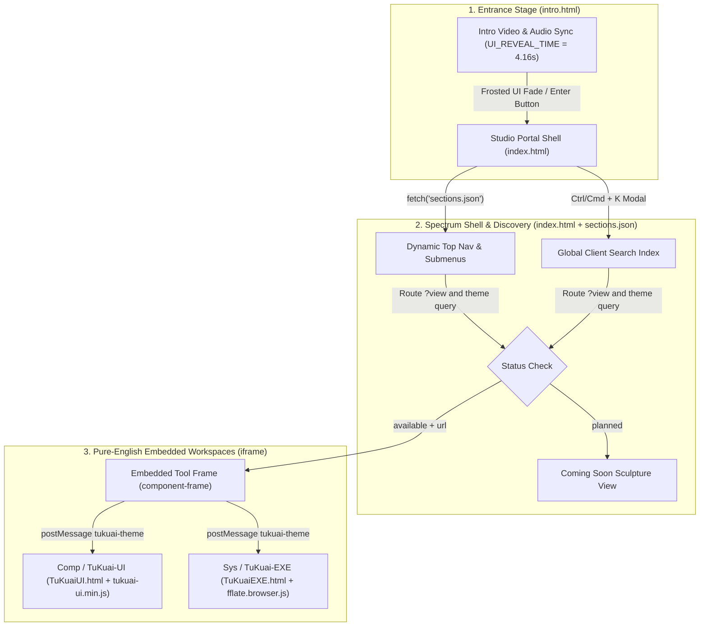

English | [繁體中文](README.zh-TW.md)

# TuKuai Studio

> Modular five-spectrum developer workshop hosting zero-dependency web tools and self-contained embedded utilities inside a single unified shell.

TuKuai Studio solves the fragmentation and bloat of everyday utility apps by organizing modular front-end components and focused developer workflows into five color-coded domains (`Comp`, `Core`, `IO`, `Net`, `Sys`). Its portal shell presents Traditional Chinese (`zh-Hant`) navigation while loading standalone, pure-English interactive workspaces (`TuKuai-UI`, `TuKuai-EXE`, and upcoming tools) inside a theme-synchronized iframe workspace.

## Architecture & Data Flow



## End-to-End Flow & Core Technologies

| Stage | Data Flow | Core Technologies | What It Accomplishes |
| :--- | :--- | :--- | :--- |
| **1. Entrance Transition** | `intro.html` → `index.html` | HTML5 Video/Audio sync, GPU `opacity` compositing (`4.16s` cue & `4.5s` timer fallback) | Synchronizes intro playback with chord timing and provides touch-gesture fallback on mobile browsers before entering the portal. |
| **2. Registry & Search** | `sections.json` → `index.html` Nav & Search Modal | `fetch` JSON registry, URL query routing (`?view=`), case-insensitive `Ctrl/Cmd + K` search | Drives top-level dropdown menus, section states (`available` vs `planned`), and bilingual/English keyword filtering without a backend. |
| **3. Theme & Frame Sync** | `index.html` → Embedded `<iframe id="component-frame">` | `?theme=` URL propagation + `window.postMessage` (`tukuai-theme`), CSS `color-scheme` | Keeps Day (`#f6f1e6` / `#ffffff`) and Night (`#0f1116` / `#111111`) palettes synchronized across the shell and embedded tools without page reloads. |
| **4. Comp · TuKuai-UI** | `assets/tukuai-ui.min.js` → `TuKuaiUI/TuKuaiUI.html` | Native Custom Elements (`<tukuai-audio>`, `<tukuai-player>`), Canvas frame capture, pure-English Code Generator | Renders zero-dependency audio/video players with 5 visual themes (`sunset`, `cyberpunk`, `ocean`, `dark`, `light`) and exports ready-to-paste English HTML/snippets. |
| **5. Sys · TuKuai-EXE** | `TuKuaiEXE/TuKuaiEXE.html` → Worker API (`exe.xn--udsye.art`) | Browser folder/ZIP intake (`fflate.browser.js`), Inno Setup cloud packaging, native GitHub Actions delivery | Compiles Windows x64 `Setup.exe` packages remotely with a single native download link (users in restricted regions should enable a proxy). |

### Five-Color Spectrum Domains

| Domain | Accent | Quote Anchor | Current Modules |
| :--- | :--- | :--- | :--- |
| `Comp` | Blue | Alan Kay | `TuKuai-UI` (Available), `TuKuai-JUI` (Planned) |
| `Core` | Green | Alan M. Turing | Planned |
| `IO` | Yellow | Claude E. Shannon | Planned |
| `Net` | Purple | Sir Tim Berners-Lee | Planned |
| `Sys` | Red | Dennis M. Ritchie | `TuKuai-EXE` (Available) |

## Directory Structure

```text
TuKuai-Studio/
├── index.html                  # Main Traditional Chinese (zh-Hant) portal shell, theme engine & iframe host
├── intro.html                  # Timed video/audio entrance stage linking to index.html
├── sections.json               # Navigation, domain hierarchy, tool URLs & search keyword registry
├── README.md                   # English documentation (primary)
├── README.zh-TW.md             # Synchronized Traditional Chinese documentation
├── 教程.md                     # Traditional Chinese guide for extending sections.json
├── AGENTS.md                   # Workspace localization rules (zh-Hant shell + pure-English embedded pages)
├── assets/
│   ├── tukuai-ui.min.js        # Pure-English <tukuai-audio> & <tukuai-player> Custom Elements library
│   └── 更新日志.md              # Traditional Chinese changelog for TuKuai-UI fixes
├── TuKuaiUI/
│   ├── TuKuaiUI.html           # Pure-English component showcase & interactive HTML generator
│   ├── imgs/                   # Video poster thumbnails
│   └── media/                  # Local demo video & audio assets
└── TuKuaiEXE/
    ├── TuKuaiEXE.html          # Pure-English embedded frontend for the Cloud Inno Setup Packager
    └── fflate.browser.js       # Client-side DEFLATE / ZIP helper
```

## License

Copyright © 2026 TuKuai. Licensed under the [Apache License 2.0](LICENSE).
