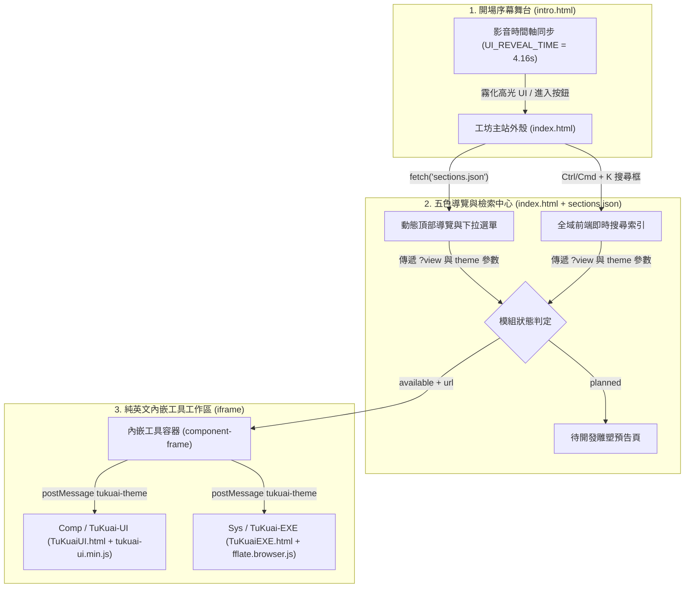

[English](README.md) | 繁體中文

# TuKuai Studio（土塊工坊）

> 以「五色光譜」為脈絡的模組化開發者工坊，在單一入口外殼中承載零依賴前端組件與純英文內嵌實作工具。

TuKuai Studio 將日常開發高頻工具依五大色彩維度（`Comp`、`Core`、`IO`、`Net`、`Sys`）沉澱為清晰獨立的模組，解決元件依賴臃腫與工具分散的問題。主站外殼採用繁體中文（`zh-Hant`）導覽體驗，並透過主題同步的 iframe 工作區統一載入純英文介面的實戰工具（如 `TuKuai-UI`、`TuKuai-EXE` 與後續模組）。

## 全鏈路架構與資料流轉圖



## 分階段流程與核心技術棧

| 階段 | 資料流向（從哪到哪） | 採用的核心專業技術 | 具體完成的工作 |
| :--- | :--- | :--- | :--- |
| **1. 開場序幕轉場** | `intro.html` → `index.html` | HTML5 Video/Audio 同步、純 `opacity` 硬體合成（`4.16s` 和弦觸發與 `4.5s` 逾時兜底） | 對齊鋼琴和弦時間點展示毛玻璃高光 UI，並在行動端無感切換觸控喚醒引導後平滑跳轉主站。 |
| **2. 清單驅動與搜尋** | `sections.json` → `index.html` 導覽列與搜尋彈窗 | 非同步 `fetch` JSON 註冊表、`?view=` 路由解析、`Ctrl/Cmd + K` 即時關鍵詞過濾 | 無後端狀態下動態渲染多級下拉選單、區分 `available` 與 `planned` 狀態，支援雙語及英文搜尋檢索。 |
| **3. 主題與容器連動** | `index.html` → 內嵌 `<iframe id="component-frame">` | `?theme=` 網址參數透傳 + `window.postMessage`（`tukuai-theme`）、CSS `color-scheme` | 免重整頁面即可讓日間與夜間調色盤在主站外殼與各純英文子頁面間即時同步切換。 |
| **4. Comp · TuKuai-UI** | `assets/tukuai-ui.min.js` → `TuKuaiUI/TuKuaiUI.html` | 原生 Custom Elements（`<tukuai-audio>`、`<tukuai-player>`）、Canvas 影格擷取、純英文程式碼生成器 | 提供零依賴音訊/視訊播放器與 5 套主題（`sunset`、`cyberpunk`、`ocean`、`dark`、`light`），並匯出標準純英文 HTML 範本。 |
| **5. Sys · TuKuai-EXE** | `TuKuaiEXE/TuKuaiEXE.html` → Worker 閘道（`exe.xn--udsye.art`） | 瀏覽器資料夾與 ZIP 打包（`fflate.browser.js`）、Inno Setup 雲端編譯、GitHub Actions 原生下載 | 遠端編譯 Windows x64 `Setup.exe` 安裝包並提供單一原生下載連結（受限地區請開啟代理存取）。 |

### 五色光譜板塊規劃

| 領域識別 | 色調 | 理念引言人物 | 目前已掛載模組 |
| :--- | :--- | :--- | :--- |
| `Comp` | 藍色 | Alan Kay | `TuKuai-UI`（已上線）、`TuKuai-JUI`（待開發） |
| `Core` | 綠色 | Alan M. Turing | 規劃建設中 |
| `IO` | 黃色 | Claude E. Shannon | 規劃建設中 |
| `Net` | 紫色 | Sir Tim Berners-Lee | 規劃建設中 |
| `Sys` | 紅色 | Dennis M. Ritchie | `TuKuai-EXE`（已上線） |

## 目錄結構

```text
TuKuai-Studio/
├── index.html                  # 主站入口外殼（繁體中文 zh-Hant），負責主題引擎與 iframe 託管
├── intro.html                  # 開場影音轉場舞台，完成後進入 index.html
├── sections.json               # 頂部導覽、板塊階層、子頁面 URL 與搜尋關鍵詞註冊表
├── README.md                   # 英文版主文件（預設入口）
├── README.zh-TW.md             # 繁體中文同步說明文件
├── 教程.md                     # 擴展 sections.json 的繁體中文實操指南
├── AGENTS.md                   # 專案語言規範（繁中外殼 + 內嵌網頁全純英文）
├── assets/
│   ├── tukuai-ui.min.js        # 純英文 <tukuai-audio> 與 <tukuai-player> 原生元件庫
│   └── 更新日志.md              # TuKuai-UI 修復紀錄（繁體中文）
├── TuKuaiUI/
│   ├── TuKuaiUI.html           # 純英文元件展示與互動式程式碼生成器頁面
│   ├── imgs/                   # 演示視訊海報縮圖
│   └── media/                  # 本機演示音訊與視訊素材
└── TuKuaiEXE/
    ├── TuKuaiEXE.html          # 純英文雲端 Inno Setup 打包前端介面
    └── fflate.browser.js       # 前端瀏覽器端 ZIP / DEFLATE 工具庫
```

## 授權條款

Copyright © 2026 TuKuai。本專案採用 [Apache License 2.0](LICENSE) 開源授權。
